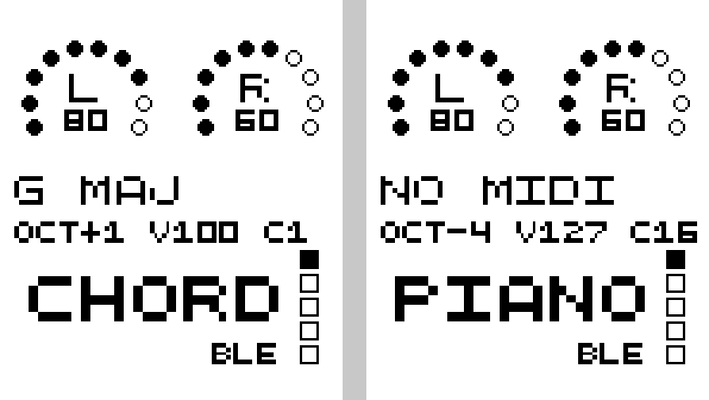

# Toucan2 as a Bluetooth MIDI controller (iPad)

The Toucan2 firmware has eight **MIDI modes**: Piano, Grid, Accordion,
Drums, Chord, Control, DJ and Scratch. In them the keys send MIDI over Bluetooth instead of keystrokes, and
the trackpad works as an XY pad and velocity slider. The keyboard connects to the iPad over the
same Bluetooth link it already uses for typing. You don't need a cable, a
dongle, or a second pairing.

The firmware side is `modules/zmk-ble-midi`, a small ZMK module added for this
build. ZMK has no MIDI support of its own. The module adds the standard
Bluetooth LE MIDI service next to the keyboard service. iPadOS treats that as
a class-compliant Bluetooth MIDI device, so any MIDI app can use it:
GarageBand, Logic Pro, AUM, Loopy Pro, Drambo, Melodics, and others.

Only the Toucan2 has this. The Corne and Corne-ish Zen builds are unchanged.

## At a glance

| To... | Do this |
|---|---|
| Turn MIDI on / off | Press **both bottom outer pinky keys together**. MIDI always starts in Piano. |
| Switch mode | Hold the **right middle thumb** (MODE) and tap **Q** Piano, **W** Grid, **E** Drums, **R** Chord, **T** Control, **Y** DJ, **U** Scratch or **I** Accordion |
| Make the iPad find it | Hold MODE and tap **Pair** (bottom-right outer key) |
| Silence stuck notes | Hold MODE and tap **Panic** (bottom-left outer key) |
| Leave MIDI | The pinky combo again, or hold MODE and tap the left outer thumb |

**About the on/off combo:**
- It's ignored for 150 ms after any other keypress. Fast playing or typing
  can't trigger it by accident, and the two keys under it never wait on it
  mid-phrase.
- After a pause, those two keys can take up to 50 ms to sound, while the
  keyboard waits to see if the other one follows. In Piano that's B2 and F4
  (F4 is also on the home row), in Grid C3 and B3.

## One-time setup

1. **Flash both halves** with the new `toucan_left.uf2` / `toucan_right.uf2`.
   The MIDI service runs on the left (central) half.
2. **Let the iPad see the new service.** The iPad caches the list of services
   from when you paired the keyboard. The firmware tells it the list changed,
   but if the MIDI device never appears in the steps below, re-pair from
   scratch:
   - iPad: Settings → Bluetooth → Toucan ⓘ → *Forget This Device*.
   - Keyboard: on the **FUN** layer, press the iPad's profile key (the
     `BT 0–3` keys on the bottom-right row) *shifted*. That clears the profile.
   - Pair again from Settings → Bluetooth.

## Connecting a MIDI app (each session)

iPadOS apps connect to Bluetooth MIDI devices themselves, from their own
"Bluetooth MIDI Devices" panel. The panel only lists devices that are
advertising MIDI. A keyboard that is already connected for typing isn't
advertising, so **Pair** makes it advertise for 60 seconds:

1. Turn MIDI on (the pinky combo).
2. Open the app's Bluetooth MIDI panel:
   - **GarageBand:** open a song → Settings (gear) → Advanced →
     *Bluetooth MIDI Devices*.
   - **Other apps** (AUM, Loopy Pro, Melodics...): look for *Bluetooth
     MIDI* in the app's settings or MIDI setup. If an app has no such panel,
     connect once from GarageBand's panel and then switch apps. The
     connection is shared by every app.
3. Hold MODE and tap **Pair**. The keyboard shows up under its Bluetooth
   name. Tap it to connect. Advertising stops by itself once the app
   connects.

The connection lasts until the keyboard disconnects: sleep, walking away, or
a Bluetooth profile switch. After that, pair again. Turning MIDI off doesn't
disconnect it, so you can flip between typing and playing freely.

## The status screen

While a MIDI mode is on, the left half's screen replaces the typing-speed
graph with the MIDI state. The big text at the bottom is the mode.



*Approximate preview, rendered from the screen's real font and coordinates.*

- **Line 1** is the key and scale, e.g. `G MAJ`. It reads **`NO MIDI`**
  until an app is connected, which makes it a quick connection check.
- **Line 2** is octave, velocity and MIDI channel: `OCT+1 V100 C1`. When
  your hands are at different octaves it shows both instead, e.g.
  `L-2 R+1 V100`.

## Shared thumbs: an octave per hand

In Piano, Grid, Accordion and Chord, **each half of the keyboard has its own octave**,
so your hands can play far apart:

```
left:  L-Oct−   Sustain   L-Oct+        right:  R-Oct−   MODE   R-Oct+
```

The two hands mirror each other: octave keys on the outside thumbs (down on
the left, up on the right) and the special key in the middle.

- **Each hand's octave keys are under its own thumb.** L-Oct moves only the
  left half's notes; R-Oct moves only the right half's.
- **Octave steps never move a note's position.** C stays under the same key,
  so you never lose your place. Each hand reaches the whole piano, just not
  all at once.
- **The screen** shows both octaves when they differ (`L-2 R+1`).
- **Accordion only:** hold an octave thumb instead of tapping it to shift
  half an octave (see Accordion below).
- **Reset both** with MODE + G (OctR).
- **Sustain** (left middle thumb, the Space position) is the sustain pedal,
  CC 64.
- **Mod wheel and Hold** are on the MODE layer: hold MODE and press **J**
  for the mod wheel (CC 1), **K** for Hold (CC 85).
- Drums and Control use their own thumbs (see below). **MODE** is always the
  right middle thumb, in every MIDI mode.

## The trackpad

On every MIDI layer the trackpad is a MIDI controller instead of a mouse. It
does three different jobs depending on how many fingers you use:

| Gesture | Does |
|---|---|
| **One finger** | **XY pad for effects.** Left/right sends **CC 16**, up/down sends **CC 17**, each 0–127. Map them with MIDI Learn to two "knobs", e.g. filter cutoff and resonance. |
| **Two fingers up / down** | **Velocity slider.** Sets how loud every note key plays, from 1 to 127. Up is louder. The screen's `V` value updates as you slide. |
| **Pinch** | **A third knob, CC 18.** Spread your fingers to raise it, pinch to lower it. |

- **The gestures can't interfere.** The trackpad itself tells one finger,
  two fingers and a pinch apart, so sliding velocity never moves the effect
  knobs and vice versa.
- **Starting values:** the three knobs start at 64. Velocity keeps whatever
  it was, and MODE + A/S still adjust it in steps of 16.
- **The mouse is off.** Clicks, scrolling and zoom do nothing on the MIDI
  layers; they come back when you turn MIDI off.

**Tuning:** the settings live on `&midi_xy` in `config/toucan.keymap` (add a
`&midi_xy { ... };` block).

| Setting | Default | Controls |
|---|---|---|
| `divisor` | 4 | How far one finger travels for the full 0–127. Higher gives finer control and needs more travel. |
| `velocity-divisor` | 2 | The same for the velocity slider |
| `velocity-invert` | off | Set this if moving your fingers up makes notes quieter |
| `pinch-cc` | 18 | Which CC pinch sends; `-1` turns pinch off |
| `pinch-divisor` | 2 | How much pinching covers the full range |

## Piano: 32 keys, laid out like a piano

GarageBand's *Musical Typing*, plus an octave of white keys below it.

- The **home row is the white keys**, starting with **middle C on the A key**.
- Each **sharp sits directly above** its natural, so the key above is one
  semitone higher. The keys above E and B are empty, as on a piano.
- The **bottom row repeats the home row an octave lower**, so the key below is
  one octave down. It's mostly for left-hand bass.

```
         outer  Q/A   W/S   E/D   R/F   T/G  │  Y/H   U/J   I/K   O/L   P/'  outer
top       --    C#4   D#4   --    F#4   G#4  │  A#4   --    C#5   D#5   --    F#5
home      B3    C4    D4    E4    F4    G4   │  A4    B4    C5    D5    E5    F5
bottom    B2    C3    D3    E3    F3    G3   │  A3    B3    C4    D4    E4    F4
```

C4 is middle C, MIDI note 60. GarageBand labels it **C3**. The layout above
is with both hands at octave 0: the left half (B3–G4 on the home row) follows
L-Oct, the right half (A4–F5) follows R-Oct. This is the mode to use for
Melodics piano lessons, because it matches the piano Melodics shows on
screen.

## Grid: 36 notes, one octave per row

Every semitone from C3 to B5 appears exactly once. Each row runs chromatically
from left to right, and the key above is an octave higher. Every C is in the
outer-left column. It's the simplest layout to reason about, but it doesn't
look like a piano.

```
         col:  1     2     3     4     5     6   │  7     8     9     10    11    12
top            C5    C#5   D5    D#5   E5    F5  │  F#5   G5    G#5   A5    A#5   B5
home           C4    C#4   D4    D#4   E4    F4  │  F#4   G4    G#4   A4    A#4   B4
bottom         C3    C#3   D3    D#3   E3    F3  │  F#3   G3    G#3   A3    A#3   B3
```

Columns 1–6 follow the left hand's octave, columns 7–12 the right's.

## Accordion: 36 notes, the button accordion layout (MODE + I)

Accordion uses the layout of the **chromatic button accordion** (C-system style).
Accordions have used this arrangement for over a century to fit many notes
on three rows of buttons, which is exactly what the Toucan has. Compared to
Grid it's more compact (an octave fits in 4 keys instead of 12) and chord
shapes are the same in every key, but it takes longer to learn. Every
semitone from **B2 to A#5** appears exactly once, three full octaves.

```
         outer  Q/A   W/S   E/D   R/F   T/G  │  Y/H   U/J   I/K   O/L   P/'  outer
top       C#3   E3    G3    A#3   C#4   E4   │  G4    A#4   C#5   E5    G5    A#5
home      C3    D#3   F#3   A3    C4    D#4  │  F#4   A4    C5    D#5   F#5   A5
bottom    B2    D3    F3    G#3   B3    D4   │  F4    G#4   B4    D5    F5    G#5
```

The whole layout follows three rules:

- **One key right = 3 semitones** (a minor third), so **4 keys right = an
  octave**.
- **One row up = 1 semitone.** Each column is three neighbouring notes.
- **Every C is on the home row,** 4 keys apart: the outer-left key (C3),
  **F** (C4, middle C, under your left index finger) and **K** (C5, under
  your right middle finger).

Shapes are the same in every key, so you learn a chord once and can play it
from anywhere:

| Interval | Shape |
|---|---|
| Major third (+4) | One key right, one row up |
| Fifth (+7) | Two keys right, one row up |
| Octave (+12) | Four keys right, same row |
| **Major triad** | Root + (1 right, 1 up) + (2 right, 1 up) |

Each hand covers about 1½ octaves: the left half B2–E4 and the right half
F4–A#5, each with its own octave on the thumbs.

**Half-octave shifts (Accordion only).** On the Accordion layer the four
octave thumbs do two things:

- **Tap** = shift that hand a whole octave, as in the other modes.
- **Hold** (about a quarter second) = shift it **half an octave**. In this
  layout that's exactly 2 keys sideways, so the whole pattern stays intact:
  every C is still on the home row, just two keys along.

Half steps let you place each hand where a piece sits on the staff, e.g. hold
R-Oct− so the right hand covers B3–E5 and middle C is under both hands. The
screen shows it as `L+0 R-0.5`. MODE + G resets both hands. Piano, Grid and
Chord ignore the half part, so a piano layout is never left half an octave
off.

**Which apps it suits.** It doesn't look like a piano, so for Melodics
lessons (which show an on-screen piano) Piano mode is the better choice. It
suits sheet-music-based apps such as Playground Sessions, where you read
notes off the staff rather than off a picture of a keyboard.

### Accordion cheat sheet

**Three ideas cover everything:**

1. **Each column is a tiny vertical piano.** The home-row key is the
   column's *anchor*. The key **above is one semitone up**, and the key
   **below is one semitone down**.
2. **The home row is a ladder of four anchors:** **C, E♭, F♯, A**, then C
   again, each 3 semitones apart. **Four keys right is an octave.**
3. **Every note is an anchor, or ±1 from one.**

| Note | Where | | Note | Where |
|---|---|---|---|---|
| C | **C** anchor | | F♯ | **F♯** anchor |
| C♯ | above C | | G | above F♯ |
| D | below E♭ | | G♯ | below A |
| E♭ | **E♭** anchor | | A | **A** anchor |
| E | above E♭ | | A♯ | above A |
| F | below F♯ | | B | below the next C |

**Landmarks:**
- **Middle C = F key** (left index finger). C3 is the left outer key and C5
  is **K** (right middle finger).
- **A sits just left of each C:** D key (A3) and J key (A4).
- Every C is on the home row, four keys apart.

**The white keys zigzag.** Going up from C: home → down-right (D) → up
(E) → down-right (F) → up (G) → home-right (A) → down-right (B) → up (C).

**Chord shapes**, the same from any starting note:

| Chord / interval | Shape from the root |
|---|---|
| Minor third (+3) | 1 key right, same row |
| Major third (+4) | 1 key right, 1 row up |
| Fifth (+7) | 2 keys right, 1 row up |
| Octave (+12) | 4 keys right, same row |
| **Major triad** | root, 1 right & up, 2 right & up |
| **Minor triad** | root, 1 right, 2 right & up |

C major from middle C: **F** (C4), the key **above G** (E4), the key
**above H** (G4).

**Reading sheet music:**
1. Find the note's anchor (C, E♭, F♯ or A).
2. Decide whether it's the anchor itself, the key above (+1) or the key
   below (−1).
3. Count octaves from middle C on the F key: four keys right or left per
   octave.

**Practice drill:**
1. Play the anchors along the home row, saying them out loud: C, E♭, F♯,
   A, C.
2. Play the C major scale from the F key: **F (C) · G-bottom (D) · G-top
   (E) · H-bottom (F) · H-top (G) · J (A) · K-bottom (B) · K (C)**.
3. Play the major-triad shape from each anchor and listen for the same
   chord quality each time.

**Accordion fingering material.** On a real chromatic button accordion the
same three rows are staggered diagonally. The Toucan's rows are straight, so
"one key right" here is a step along an accordion row, and "one row up" is
the accordion's diagonal semitone step. Each button has the same neighbours
as on an accordion. C-system fingering patterns therefore carry over as
shapes; the button-by-button diagrams won't line up exactly.

**Prior art.** Playing a computer keyboard as a button accordion has been
done before. Examples:
- [Keydion](https://github.com/r00tman/Keydion) (macOS, C-system)
- [Akkeyrdion](https://sourceforge.net/projects/akkeyrdion/) (C and B
  systems)
- [Maccordion](https://maccordion.com/) (browser, B-system)
- A [Bayan mapping for FL Studio](https://summivox.wordpress.com/2016/04/25/bayan-keyboard-mapping-for-fl-studio/)

All of them run as software on an ordinary staggered laptop keyboard. The
version here differs in a few ways:
- It runs in the keyboard's own firmware.
- It uses a split keyboard with straight columns, over Bluetooth MIDI.
- Each hand has its own octave and half-octave shifts.

## Drums: a General MIDI kit

Each key plays a fixed drum sound; octave and key shifts don't affect it. It
uses the standard General MIDI drum notes, which GarageBand drum kits,
Melodics pad lessons and most drum apps understand. Kick and snare are under
your index fingers **and** on the thumbs, like pedals.

```
         outer   Q/A    W/S    E/D    R/F    T/G   │  Y/H    U/J    I/K    O/L    P/'    outer
top      Crash2 Splash OpenHH Crash  HiTom  HMTom  │  LMTom  LoTom  Ride   Bell   China  Ride2
home     Tamb   Stick  HiHat  Snare  Kick   Clap   │  Kick   Snare  FlrHi  FlrLo  Cowbl  Maraca
bottom   Claves PedHH  Snare2 BongoH BongoL CongaO │  CongaM CongaL TimbH  TimbL  Tri    Cabasa
thumbs                 HiHat  Kick   PedHH         │  Snare  MODE   Clap
```

## Chord: one key, one chord, in any key

The chord keys play the chords that belong to the current key, not fixed
chords. Change the key and every chord follows, so the same hand shapes work
in any key.

The columns are scale degrees I–VII, then I–III an octave up. Each row plays
them differently:

- **Top row:** seventh chords (four notes)
- **Home row:** triads (three notes)
- **Bottom row:** just the root, an octave lower, as a bass note for your
  left hand

```
         outer  Q/A   W/S   E/D   R/F   T/G  │  Y/H   U/J   I/K   O/L   P/'   outer
top       Key−  I7    ii7   iii7  IV7   V7   │  vi7   vii7  I7'   ii7'  iii7'  Key+
home      Maj/m I     ii    iii   IV    V    │  vi    vii   I'    ii'   iii'   Inv
bottom    Panic I     ii    iii   IV    V    │  vi    vii   I'    ii'   iii'   Reset
```

In C major the home row plays C Dm Em F G Am Bdim C Dm Em. Switch to G major
and the same keys play G Am Bm C D Em F#dim G Am Bm.

| Key | Does |
|---|---|
| Key− / Key+ | Move the key a semitone. The screen shows it, e.g. `G MAJ`. Key shifts Piano and Grid too, so they transpose along with it. |
| Maj/m | Switch between major and (natural) minor |
| Inv | Cycle root position → 1st → 2nd inversion. Inversions keep chord changes closer together, so they sound smoother. |
| Reset | Back to C major, root position, octave 0 |

## Control: a MIDI Learn control surface

Keys for AUM, Loopy Pro, Logic and other apps that let you map controls with
MIDI Learn.

```
         outer  Q/A   W/S   E/D   R/F   T/G  │  Y/H   U/J   I/K   O/L   P/'  outer
top       PC−   T20   T21   T22   T23   T24  │  T25   T26   T27   T28   T29   PC+
home      Ch−   M102  M103  M104  M105  M106 │  M107  M108  M109  M110  M111  Ch+
bottom    Panic Rec   Play  Stop  Cont  Vel− │  Vel+  Oct−  Oct+  Key−  Key+  Pair
thumbs                Rec   Play  Stop       │  --    MODE  --
```

- **T20–T29** are CC toggles: each press alternates 127 / 0. Use them for
  mutes, effects on/off, or loop tracks.
- **M102–M111** send CC 127 while held. Use them for clip or scene launch and
  other momentary actions.
- **PC−/+** send the previous or next program change, which switches patches
  in apps that support it. **Ch−/+** change the MIDI channel.
- **Rec / Play / Stop** send MIDI Machine Control (MMC). Play and Stop also
  send MIDI Start / Stop. Whether they work depends on the app; if one
  ignores them, map a toggle key with MIDI Learn instead.

## DJ: two decks for djay

For Algoriddim **djay** on iPad, or any DJ app with MIDI Learn. Your left
hand is deck 1 and your right hand is deck 2.

```
per hand, pinky → index (the right hand is the mirror image)
top      Load   HC1     HC2     HC3     HC4     FX1
home     PFL    Loop÷2  Loop×2  Loop    Play    Cue
bottom   Sync   LoopIn  LoopOut Nudge−  Nudge+  FX2
thumbs   Browse↑  Browse↓  Spare1  │  Spare2  MODE  Spare3
```

- **The decks are mirror images.** Each function is under the same finger on
  both hands: Play is under each index finger, hot cue 1 under each pinky.
- **HC1–HC4** are hot cues. **PFL** is headphone cue. **Loop** turns an auto
  loop on or off; **Loop÷2 / Loop×2** halve or double it.
- **Cue and Nudge act while held,** like the real buttons.
- **Spare1–3** (thumbs) are free for anything, e.g. Record, Undo or Automix.
- **The trackpad:**
  - one finger left/right is the **crossfader** (CC 1)
  - one finger up/down is **CC 2**, e.g. a filter or FX amount
  - two fingers up/down is **CC 3**, e.g. the other deck's filter
  - pinch is **CC 4**

  There's no velocity slider here; a DJ app doesn't use velocity.
- **Everything is on MIDI channel 16.** The other modes use channel 1, so
  playing Piano or Drums with djay still open can't trigger your DJ mappings.
- **The screen** shows the MIDI connection as in other modes. Its key and
  scale line doesn't mean anything here.

**Setting it up in djay.** MIDI Learn is part of djay PRO.

1. Connect the keyboard: in djay, **MIDI → Connect Bluetooth Controller**,
   then hold MODE and tap **Pair** on the keyboard.
2. Switch to DJ mode (MODE + Y).
3. Open djay's **MIDI Learn**. For each control, tap the djay function, then
   press the key or move the trackpad.
4. Save the mapping. It stays saved, so you only do this once.

## Scratch: turntablism with the trackpad

For scratching in djay. Your right hand works the record on the trackpad,
and your left hand cuts the crossfader.

```
         outer  Q/A    W/S    E/D    R/F    T/G  │  Y/H     U/J     I/K     O/L
top       --    Deck1  Deck2  --     --     --   │  1:HC1   1:HC2   1:HC3   1:HC4
home      --    CUT    CUT    CUT    CUT    --   │  2:HC1   2:HC2   2:HC3   2:HC4
bottom    --    --     --     --     --     --   │  1:Play  1:Cue   2:Play  2:Cue
thumbs                                           │          MODE
```

**Right hand: the trackpad is the record.**

| You do | Like on a turntable |
|---|---|
| Put a finger down | Hand on the record: it stops under your finger |
| Slide left / right | Drag the record back / forward |
| Lift the finger | Let go: the record plays on |

**Left hand: the crossfader.**

- **A, S, D and F all cut the sound.** While any of them is held, the
  crossfader is on the far side and the scratched deck is silent. Release
  them all and the sound comes back.
- **Cuts can roll across fingers.** The sound only returns when the last key
  is released, so alternating fingers gives fast cuts.
- **Deck1 / Deck2** (Q / W) choose which deck you're scratching. The screen
  shows `DECK 1` or `DECK 2`, and choosing a deck also opens the crossfader
  for it. Tap one when you enter Scratch mode so the fader starts in the
  right place.

**Hot cues, Play and Cue for both decks** are on the right hand, for jumping
back to the sample between scratches. They send the same notes as in DJ
mode, so mappings you've already learned there work here too.

**Setting it up in djay** (MIDI Learn, djay PRO), with the keyboard in
Scratch mode:

1. **The jog wheel:** in MIDI Learn, pick deck 1's jog wheel (touch and
   turn), then touch the pad and slide. Tap **Deck2** (W) and do the same for
   deck 2.
2. **The crossfader:** pick the crossfader, then press any CUT key. If
   you've already mapped the crossfader to the trackpad in DJ mode, it's
   already done: both modes use the same control (CC 1, channel 16).
3. **Vinyl mode:** turn on djay's vinyl / scratch mode for the deck.
   Touching the record then stops it and sliding scratches; with it off,
   the jog wheel only nudges the speed.

**Tuning:** the settings live on `&midi_jog` in `config/toucan.keymap` (add a
`&midi_jog { ... };` block).

| Setting | Default | Controls |
|---|---|---|
| `divisor` | 1 | Trackpad movement per jog step. Raise it if scratches feel too fast. |
| `invert` | off | Set this if sliding right drags the record backward |
| `encoding` | `"offset64"` | How the movement is encoded. Try `"twos-complement"` if djay's jog wheel moves erratically or only in one direction. |

**What to expect.** Bluetooth adds about 10–20 ms of delay, with some
jitter, so the sound trails your finger slightly.

- **Works well:** baby scratches, drags and backspins.
- **Feels mushy:** very fast techniques, like flares and crabs.

The cut keys are the tightest part: a key press is quicker than any slider.

**Messages sent** (all on MIDI channel 16):

- **Jog:** CC 20 for deck 1, CC 21 for deck 2, relative.
- **Platter touch:** note 20 for deck 1, note 52 for deck 2.
- **Crossfader:** CC 1. When cutting deck 1 it goes to 127; when cutting
  deck 2 it goes to 0. Each deck's open position is the opposite end.

## The MODE layer

Hold the right middle thumb:

```
         outer  Q/A    W/S    E/D    R/F    T/G   │  Y/H    U/J   ...
top       --    Piano  Grid   Drums  Chord  Ctrl  │  DJ     Scrch  Accrd
home      --    Vel−   Vel+   Ch−    Ch+    OctR  │  KeyR   Mod   Hold
bottom    Panic --     --     --     --     --    │  ...                Pair
thumbs    Exit (left outer)
```

## What works where

- **Notes and drums** work in any instrument app. GarageBand plays whichever
  instrument is open.
- **Melodics:** use **Piano** for keys lessons and **Drums** for pad lessons.
  Melodics filters lessons by how many keys your controller has. Some wider
  keys lessons may still be out of reach, and every note plays at the same
  velocity.
- **CCs, the trackpad knobs and transport** need an app with MIDI Learn: AUM, Loopy
  Pro, Logic Pro, Drambo and most synths. GarageBand only responds to sustain
  (CC 64) and the mod wheel (CC 1).

## Customizing

All the layouts are in `miryoku/miryoku_midi.h`, one row per line. These
bindings are available:

```c
&midi_note MIDI_N(MN_FS, 4)   // a note, moved by Oct and Key
&midi_drum GM_SNARE           // a fixed note (GM_* names for the drum map)
&midi_chord (MC_V | MC_7TH)   // chord on a scale degree; MC_BASS, MC_8VA
&midi_cc 74                   // CC 74 = 127 while held, 0 on release
&midi_cc_tog 80               // CC 80 toggles 127 / 0
&midi_ctl MIDI_OCT_UP         // a command, see below
```

`&midi_ctl` commands: `MIDI_OCT_DN/UP/RST`, `MIDI_KEY_DN/UP/RST`,
`MIDI_SCALE`, `MIDI_INV`, `MIDI_VEL_DN/UP`, `MIDI_CH_DN/UP`, `MIDI_PC_DN/UP`,
`MIDI_PANIC`, `MIDI_PLAY`, `MIDI_STOP`, `MIDI_CONT`, `MIDI_REC`, `MIDI_PAIR`.
The full list with comments is in
`modules/zmk-ble-midi/include/dt-bindings/zmk/midi.h`.

The Kconfig options, such as the default velocity and how long Pair
advertises, are in `modules/zmk-ble-midi/Kconfig`. Set them in
`config/toucan_left.conf`.

**The status screen** is drawn by beekeeb's Toucan2 module, which lives
outside this repo. `patches/toucan2-midi-status.patch` adds the MIDI panel,
and CI applies it to a pinned commit of that module. To move to a newer
upstream commit, bump the SHA in `.github/workflows/build-firmware.yml` and
refresh the patch. The panel only exists in the default screen style
(`CONFIG_TOUCAN_STATUS_SCREEN=2`).

## Limits

- **Velocity is a setting, not per keystroke.** Key switches can't
  sense how hard you press, so every note uses the current Vel−/Vel+ setting.
- **Bluetooth only, to the active profile.** MIDI goes to the host on the
  currently selected Bluetooth profile. It doesn't go over USB.
- **Latency** is set by the Bluetooth connection interval the iPad chooses,
  typically 7.5–15 ms. That's fine for playing and triggering, but not for
  sample-tight drumming.
- **Not yet tried on the keyboard with an iPad.** The firmware builds and
  every layer decodes to the layouts above, but none of it has been used on
  the real board yet. The first things to check are the Pair → connect flow,
  the screen, the direction of the velocity slider, and the trackpad travel
  settings.
